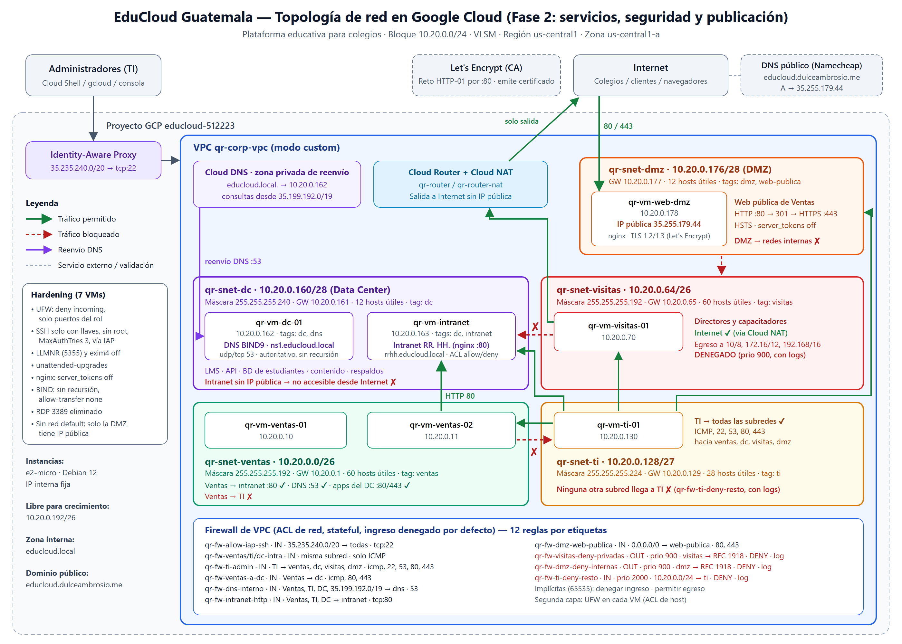

# Universidad del Valle de Guatemala
# Facultad de Ingeniería
## Departamento de Computación
## CC3067 Redes de Computadoras

# EduCloud: Diseño de Red corporativa en Google Cloud

| Integrante | Carné |
|---|---|
| Nadissa Vela | 23764 |
| Dulce Ambrosio | 231143 |
| Paula de León | 23202 |
| Juan Cruz | 23110 |
| Cindy Gualim | 21226 |

---

## Nuestro caso de uso

**EduCloud Guatemala** es una startup que vende licencias de una plataforma educativa (aula virtual, notas, asistencia y comunicación con padres) a colegios. En lugar de tener un cuarto de servidores propio, toda la red está en Google Cloud Platform (GCP).

| Segmento | Usuarios / equipos | Uso |
|---|---|---|
| Ventas | 25 personas | CRM, demostraciones, cotizaciones |
| TI | 15 personas | Desarrollo y administración de la infraestructura |
| Data Center | 5 servidores | Web/LMS, API, base de datos, contenido, respaldos |
| Visitas | hasta 50 dispositivos | Directores y capacitadores; **solo Internet** |
| DMZ (Fase 2) | 1 servidor | Web pública de Ventas |

---

## Cumplimiento de la Fase 2

| Requerimiento del enunciado | Solución implementada | Evidencia |
|---|---|---|
| **DNS interno** para administrar y resolver nombres | **BIND9** autoritativo de `educloud.local` en `qr-vm-dc-01` + **zona privada de reenvío** en Cloud DNS | Pruebas 1–3 |
| **Intranet de RR. HH.** con HTML estático, por nombre y solo desde dentro | **nginx** en `qr-vm-intranet` (sin IP pública) → `http://rrhh.educloud.local` | Pruebas 4–6 |
| **Visitas** con Internet, pero **sin** subredes internas | **Cloud NAT** + regla de egreso que deniega RFC 1918 | Pruebas 6–8 |
| **TI** llega a todas; **nadie** llega a TI | `qr-fw-ti-admin` + `qr-fw-ti-deny-resto` (con registro) | Pruebas 9–14 |
| Intranet desde las demás subredes (excepto Visitas), **no** desde Internet | `qr-fw-intranet-http` (Ventas, TI, DC) + ACL de nginx + sin IP pública | Pruebas 4–6 |
| **Hardening**: cerrar puertos innecesarios en todas las instancias | UFW por rol, SSH endurecido, LLMNR/exim4 apagados, red `default` eliminada | Pruebas 20–22, `nmap` |
| **DMZ** con la web pública de Ventas y **dominio público** | Subred `qr-snet-dmz` + `qr-vm-web-dmz` con IP estática → **https://educloud.dulceambrosio.me** | Pruebas 15–19 |
| **Puntos extra:** SSL/TLS y redirección HTTP → HTTPS | **Let's Encrypt**, TLS 1.2/1.3, **301** a HTTPS y HSTS | Pruebas 15–17 |

> **Resultado:** las **22 pruebas** de la matriz final dieron el resultado esperado ([`gcp/resultados_fase2.txt`](gcp/resultados_fase2.txt)).

---

## Diagrama de red



Diagramas de la Fase 1: [`docs/diagrama.jpeg`](docs/diagrama.jpeg) y [`docs/diagrama_jerarquico.png`](docs/diagrama_jerarquico.png).

---

## Por qué Google Cloud

Comparación ponderada de 6 criterios técnicos: **GCP 4.90**, AWS 4.20, Azure 4.00.

- VPC global con subredes de cualquier tamaño desde /29: el plan VLSM se mapea 1:1.
- Firewall por **network tags**: una VM nueva hereda la política con solo asignarle su etiqueta.
- **Ingreso denegado por defecto** y **IAP** para SSH: ninguna VM interna tiene IP pública.
- Reserva **4** direcciones por subred (AWS y Azure reservan 5).
- Facturación por segundo e instancias e2-micro.

Región del prototipo: `us-central1` (zona `us-central1-a`).

---

## Direccionamiento (VLSM sobre 10.20.0.0/24)

Supuestos: 20 % de crecimiento por segmento y 4 direcciones reservadas por GCP en cada subred (útiles = 2ʰ − 4).

| Subred | Nombre en GCP | CIDR | Gateway | Útiles |
|---|---|---|---|---|
| Ventas | `qr-snet-ventas` | 10.20.0.0/26 | 10.20.0.1 | 60 |
| Visitas | `qr-snet-visitas` | 10.20.0.64/26 | 10.20.0.65 | 60 |
| TI | `qr-snet-ti` | 10.20.0.128/27 | 10.20.0.129 | 28 |
| Data Center | `qr-snet-dc` | 10.20.0.160/28 | 10.20.0.161 | 12 |
| **DMZ (Fase 2)** | `qr-snet-dmz` | 10.20.0.176/28 | 10.20.0.177 | 12 |
| Libre | — | 10.20.0.192/26 | — | crecimiento |

La DMZ ocupó el bloque que el plan de la Fase 1 dejó libre: **no hubo que rediseñar la red**.

### Instancias (e2-micro, Debian 12, IP interna fija)

| VM | IP interna | Tags | Rol |
|---|---|---|---|
| `qr-vm-ventas-01` | 10.20.0.10 | `ventas` | Cliente de prueba |
| `qr-vm-ventas-02` | 10.20.0.11 | `ventas` | Cliente de prueba |
| `qr-vm-visitas-01` | 10.20.0.70 | `visitas` | Cliente de prueba |
| `qr-vm-ti-01` | 10.20.0.130 | `ti` | Administración |
| `qr-vm-dc-01` | 10.20.0.162 | `dc`, `dns` | **DNS interno (BIND9)** |
| `qr-vm-intranet` | 10.20.0.163 | `dc`, `intranet` | **Intranet RR. HH. (nginx)** |
| `qr-vm-web-dmz` | 10.20.0.178 / **35.255.179.44** | `dmz`, `web-publica` | **Web pública (nginx + TLS)** |

**Solo `qr-vm-web-dmz` tiene IP pública.** El resto sale a Internet por Cloud NAT y se administra por SSH a través de IAP.

---

## Servicios implementados

### 1. DNS interno: BIND9 + Cloud DNS
- **BIND9** en `qr-vm-dc-01` es **autoritativo** de `educloud.local` ([`configs/bind/`](configs/bind/)).
  - Registros: `ns1`, `dc-01`, **`rrhh` → 10.20.0.163**, `intranet` (CNAME a `rrhh`), `web-dmz` y los equipos de prueba.
  - Hardening: `recursion no`, `allow-query` solo para subredes de empleados, `allow-transfer { none; }` y versión oculta.
- **Zona privada de reenvío** `qr-zona-educloud-local` en Cloud DNS: las VMs consultan al DNS de GCP (169.254.169.254), que reenvía `*.educloud.local` a BIND. Así **no hay que tocar `/etc/resolv.conf`** en ninguna VM, y los nombres de Internet se siguen resolviendo normalmente.

### 2. Intranet de RR. HH.
- `qr-vm-intranet` en la subred del Data Center, **sin IP pública**.
- nginx sirve una página estática en **`http://rrhh.educloud.local`** ([`configs/nginx/intranet.conf`](configs/nginx/intranet.conf), [`configs/html/rrhh/`](configs/html/rrhh/)).
- Dos capas de control: la regla de VPC `qr-fw-intranet-http` y una **ACL `allow/deny` en nginx** para Ventas, TI y DC.

### 3. DMZ y web pública de Ventas con HTTPS
- `qr-vm-web-dmz` en `qr-snet-dmz`, con IP estática `qr-ip-web-dmz` y registro A en Namecheap: **https://educloud.dulceambrosio.me**.
- nginx en dos etapas:
  1. HTTP para el reto **HTTP-01** de Let's Encrypt ([`web-publica-http.conf`](configs/nginx/web-publica-http.conf)).
  2. Configuración final ([`web-publica.conf`](configs/nginx/web-publica.conf)): **80 → 301 a HTTPS**; 443 con TLS 1.2/1.3, HTTP/2, **HSTS** y cabeceras de seguridad.
- Certificado de Let's Encrypt con renovación automática (`certbot.timer`).
- **La DMZ no puede iniciar conexiones hacia la red interna** (`qr-fw-dmz-deny-internas`): si la web se compromete, el atacante queda encerrado.

### 4. Salida a Internet: Cloud Router + Cloud NAT
`qr-router-nat` da salida a Ventas, Visitas, TI y DC sin IPs públicas y sin permitir conexiones entrantes. La DMZ no se incluye porque tiene IP propia.

---

## Firewall y ACLs en GCP

En GCP el firewall de VPC es **stateful**, se aplica por **etiquetas** y tiene reglas implícitas de *deny ingress* y *allow egress*. Cumple el papel de las ACLs de red.

| Regla | Dir. | Prio. | Origen → destino | Puertos | Acción |
|---|---|---|---|---|---|
| `qr-fw-allow-iap-ssh` | IN | 1000 | 35.235.240.0/20 → todas | tcp:22 | Permitir |
| `qr-fw-ventas-intra` | IN | 1000 | Ventas → `ventas` | icmp | Permitir |
| `qr-fw-ti-intra` | IN | 1000 | TI → `ti` | icmp | Permitir |
| `qr-fw-dc-intra` | IN | 1000 | DC → `dc` | icmp | Permitir |
| `qr-fw-ti-admin` | IN | 1000 | TI → `ventas, dc, visitas, dmz` | icmp, 22, 53, 80, 443 | Permitir |
| `qr-fw-ventas-a-dc` | IN | 1000 | Ventas → `dc` | icmp, 80, 443 | Permitir |
| `qr-fw-dns-interno` | IN | 1000 | Ventas, TI, DC, Cloud DNS → `dns` | tcp/udp 53 | Permitir |
| `qr-fw-intranet-http` | IN | 1000 | Ventas, TI, DC → `intranet` | tcp:80 | Permitir |
| `qr-fw-dmz-web-publica` | IN | 1000 | 0.0.0.0/0 → `web-publica` | tcp:80, 443 | Permitir |
| `qr-fw-visitas-deny-privadas` | OUT | 900 | `visitas` → RFC 1918 | todos | **Denegar** (log) |
| `qr-fw-dmz-deny-internas` | OUT | 900 | `dmz` → RFC 1918 | todos | **Denegar** (log) |
| `qr-fw-ti-deny-resto` | IN | 2000 | 10.20.0.0/24 → `ti` | todos | **Denegar** (log) |

**Consideraciones de configuración en GCP:**
- **Stateful:** las respuestas a una conexión permitida regresan solas. Por eso la DMZ puede responderle a TI aunque tenga denegada la salida.
- La regla de egreso de Visitas es necesaria porque el **egreso se permite por defecto**.
- Las reglas implícitas no se pueden registrar. `qr-fw-ti-deny-resto` existe para **dejar evidencia en Cloud Logging** de los intentos de llegar a TI.
- Firewall Rules Logging **solo registra TCP/UDP**. Los pings se bloquean igual, pero no aparecen; para la evidencia se usó `curl` al puerto 80.

**Cambios respecto a la Fase 1:** las reglas intra-subred pasaron de todos los puertos a **solo ICMP**, se quitó **RDP (3389)**, TI ahora administra también la DMZ y se activó el registro en las denegaciones.

### Defensa en profundidad
Cada servicio está protegido por varias capas independientes:

1. Firewall de VPC.
2. **UFW** en cada VM.
3. ACL en la aplicación (nginx y BIND).
4. Ausencia de IP pública.

### Hardening de host
[`configs/hardening/hardening.sh`](configs/hardening/hardening.sh), aplicado por rol (`cliente`, `dns`, `intranet`, `web`) en las 7 VMs:

- **UFW:** *deny incoming*; SSH solo desde IAP y TI; solo los puertos del rol (53 en el DNS, 80 en la intranet, 80/443 en la web).
- **SSH:** sin root, sin contraseñas, `MaxAuthTries 3`, sin X11.
- **Servicios innecesarios apagados:** LLMNR (5355) y exim4 (25).
- **`unattended-upgrades`** activado.
- **Red `default` eliminada**, porque abría 22 y 3389 a Internet.

---

## Pruebas

### Fase 1: [`gcp/resultados_ping.txt`](gcp/resultados_ping.txt)
8 pings: conectividad dentro de Ventas, TI → DC y TI → Ventas; bloqueo de Ventas → TI y de Visitas → Ventas/DC.

### Fase 2: [`gcp/resultados_fase2.txt`](gcp/resultados_fase2.txt) (22/22)

| Pruebas | Qué confirman |
|---|---|
| 1–3 | `rrhh.educloud.local` → 10.20.0.163, el CNAME funciona y BIND rechaza la recursión (`REFUSED`) |
| 4–6 | Intranet: Ventas y TI → **HTTP 200**; Visitas → **timeout** |
| 7–8 | Visitas: Internet por NAT **sí**; red interna **no** |
| 9–14 | Ventas y DC **no** llegan a TI; TI llega a Ventas, Visitas, DC y DMZ |
| 15–17 | Web: **301 → HTTPS**, HTTP/2 200 con HSTS, certificado **Let's Encrypt** |
| 18–19 | La DMZ **no** llega a la intranet ni al DNS interno |
| 20–22 | UFW activo, SSH endurecido, **solo la DMZ con IP pública** |

Las capturas de evidencia están en [`Captura EduCloude/`](Captura%20EduCloude/): resolución DNS, bloqueos entre subredes, registros de Cloud Logging, web con candado, `nmap` y hardening.

---

## Cómo reproducir

Todo se ejecuta desde **Cloud Shell** (trae `gcloud`). La infraestructura se crea con scripts; la configuración de los servicios se hizo dentro de cada VM con los archivos de [`configs/`](configs/).

```bash
git clone https://github.com/nadissa1508/EduCloud.git && cd EduCloud/gcp
# Ajustar PROJECT_ID y, si cambia, el dominio en config.env
chmod +x *.sh
```

| Paso | Script | Qué crea |
|---|---|---|
| 1 | `01_crear_red.sh` | VPC `qr-corp-vpc` (modo custom), 4 subredes y las reglas base |
| 2 | `02_crear_instancias.sh` | 5 VMs sin IP pública |
| 3 | `03_pruebas_ping.sh` | Matriz de pings de la Fase 1 |
| 4 | `05_red_fase2.sh` | Subred DMZ, IP estática, Cloud Router y Cloud NAT |
| 5 | `06_firewall_fase2.sh` | Reestructura del firewall y reglas nuevas |
| 6 | `07_dns_gcp.sh` | Etiqueta `dns`, API y zona de reenvío. **Luego, BIND9 dentro de `qr-vm-dc-01`** con `configs/bind/` |
| 7 | `08_intranet_vm.sh` | VM de la intranet. **Luego, nginx** con `configs/nginx/intranet.conf` |
| 8 | `09_web_dmz_vm.sh` | VM de la DMZ. **Luego, nginx en dos etapas + certbot** |
| 9 | `10_hardening_todas.sh` | Aplica `hardening.sh` en 6 VMs (en `qr-vm-dc-01` se hizo a mano con el rol `dns`) |
| 10 | `11_pruebas_fase2.sh` | Matriz final de 22 pruebas |

**Entrar a una VM:**
```bash
gcloud compute ssh qr-vm-ventas-01 --zone=us-central1-a --tunnel-through-iap
```

**Apagar todo** (detenidas solo cobran el disco):
```bash
bash 04_apagar.sh
```

> `99_destruir_todo.sh` **elimina todos los recursos** del proyecto. Úsenlo solo al terminar el curso.

---

## Estructura del repositorio

```text
EduCloud/
├── gcp/                      Scripts de gcloud y resultados de pruebas
│   ├── config.env            Variables compartidas (proyecto, CIDR, IPs, dominio)
│   ├── 01–04, 99             Fase 1: red, instancias, pings, apagado, destrucción
│   ├── 05–11                 Fase 2: DMZ/NAT, firewall, DNS, intranet, web, hardening, pruebas
│   ├── resultados_ping.txt
│   └── resultados_fase2.txt
├── configs/                  Archivos de configuración utilizados (entregable)
│   ├── bind/                 named.conf.options, named.conf.local, db.educloud.local
│   ├── nginx/                intranet.conf, web-publica-http.conf, web-publica.conf
│   ├── html/                 Páginas de la intranet (rrhh) y de la web pública
│   └── hardening/            hardening.sh
├── docs/                     Informes (Fase 1 y Fase 2) y diagramas
└── Captura EduCloude/        Capturas de evidencia
```

---

## Entregables

| Entregable | Dónde |
|---|---|
| Reporte actualizado sobre el de la Fase 1 | [`docs/Proyecto Final - Fase 2.pdf`](docs/Proyecto%20Final%20-%20Fase%202.pdf) |
| Diagrama actualizado (DMZ, firewall, DNS, servidores web) | [`docs/diagrama_red_v2.png`](docs/diagrama_red_v2.png) |
| Explicación de los servicios y del firewall en GCP | Reporte y este README |
| Screenshots de funcionamiento | [`Captura EduCloude/`](Captura%20EduCloude/) y figuras del reporte |
| Tabla de aportes y tiempo estimado | Reporte, sección "Distribución del Trabajo" (resumen abajo) |
| Archivos de configuración | [`configs/`](configs/) y Anexo A del reporte |

### Distribución del trabajo (Fase 2)

| Integrante | Servicios y configuraciones | Tiempo estimado |
|---|---|---|
| Dulce Ambrosio | Subred DMZ, IP estática, Cloud Router/NAT, dominio público, matriz de pruebas, control de costos | 4 h |
| Nadissa Vela | Reestructura del firewall, 5 reglas nuevas, registros en Cloud Logging, eliminación de la red `default` | 4 h |
| Cindy Gualim | Cloud DNS (zona de reenvío), BIND9, validaciones y pruebas con `dig` | 4 h |
| Paula de León | Intranet de RR. HH. (VM, nginx, página, ACL) y hardening de host | 4 h |
| Juan Cruz | Web pública en la DMZ, Let's Encrypt, HTTPS/301/HSTS, renovación y pruebas externas | 4 h |
| **Total** | | **20 h** |

---

## Costos

| Situación | Costo aproximado |
|---|---|
| Las 7 VMs encendidas | ≈ US$ 0.08/h |
| Todo apagado (discos, IP estática, NAT, zona DNS) | ≈ US$ 0.40/día |

Hay una alerta de presupuesto de US$ 5 (avisos al 50, 90 y 100 %). Las VMs se apagan al terminar cada sesión.

---
